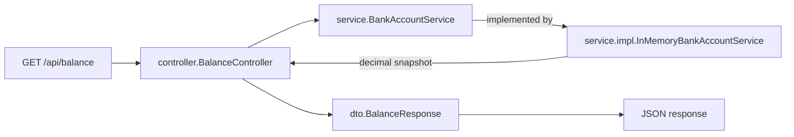

# Design Walkthrough

## Start with the application entry point

`FinancialAccountBalanceTrackerApplication` starts the application and enables
component scanning beneath its base package. The controller and service
implementation are discovered through their framework annotations.
`ProducerConfiguration` wires the random transaction factory and lifecycle-managed
producer when `tracker.producer.enabled` is true or unspecified.
`AuditConfiguration` creates the collector, bounded dispatcher and downstream
handler. The dispatcher's lifecycle phase starts it before the producers and
stops it after producer shutdown. The default downstream handler delegates packing
to `AuditBatchingService`, maps the result to DTOs and prints a JSON line.

## Follow a balance enquiry

1. `BalanceController` receives the GET request.
2. Constructor injection gives the controller a `BankAccountService`. The
   controller depends on the interface rather than constructing an implementation.
3. `InMemoryBankAccountService` reads the balance while holding the same monitor
   used for transaction updates.
4. The controller constructs a `BalanceResponse` DTO from the decimal snapshot
   and the GBP currency code.
5. The framework serializes the DTO as JSON. The controller also sets the HTTP
   status and cache-control header.

The controller handles HTTP concerns. Calculation and synchronization belong to
the service implementation. DTOs define external response shapes, while models
represent internal business data. The audit output follows the same separation.

## Follow a transaction

`model.Transaction` is an immutable record containing an ID and a signed amount.
Its constructor requires both values, rejects zero amounts and rejects fractional
pennies. Amounts are normalized to two decimal places without rounding.

`enums.TransactionType` names the two supported classifications: `CREDIT` and
`DEBIT`. The package is named `enums` because `enum` is a Java keyword.
`Transaction.type()` derives the classification from the amount's sign, keeping
the type consistent with the amount.

`BankAccountService.processTransaction` accepts a transaction. Inside a
synchronized method, the implementation calculates the next balance, records the
transaction with `TransactionAuditService`, then commits the balance. A rejected
audit hand-off leaves the balance unchanged.
The producers call this interface; they do not perform balance calculations
themselves.

## Follow automatic generation

`producer.RandomTransactionFactory` selects a random integer number of pennies
between 20,000 and 50,000,000 inclusive. It converts that value to a decimal amount,
applies the sign for the requested `TransactionType` and creates a random UUID.
Thread-local randomness supports calls from both producer threads.

`producer.TransactionProducer` owns two separate single-thread scheduled
executors. One executes credit generation on `credit-producer`; the other executes
debit generation on `debit-producer`. A fixed-rate period of 40 ms gives each a
target rate of 25 transactions per second.

The class implements `SmartLifecycle`. Startup schedules both recurring tasks,
and repeated startup calls do not create duplicate tasks. Shutdown cancels future
runs and waits for in-flight work with bounded timeouts. A runtime failure during
generation or processing logs an error and requests shutdown of both workers.
That failure path requests shutdown without waiting for the current worker to
join itself.

The configuration flag can remove the producer beans entirely. This keeps manual
balance checks and HTTP tests deterministic while allowing the normal application
to generate transactions automatically.

## Follow audit collection

The collector keeps a partial window until the next transaction completes it.
It creates a defensive, immutable snapshot and offers it to the bounded queue.
Only a successful hand-off clears the partial window and advances the sequence.
This lets the account service reject a completing transaction without changing
its balance when the queue cannot accept the submission.

The queue hand-off does not wait for downstream work. Snapshot creation remains
inside the short transaction operation and costs O(N) at each window boundary.
The dedicated worker processes complete windows in FIFO order outside balance
locks. A slow handler therefore does not hold up balance enquiries.

On a handler failure, the dispatcher retains the failed in-flight submission and
the queued windows, logs the error and rejects new complete windows. There is no
automatic downstream retry. On normal shutdown, producers stop first and the
audit worker drains completed windows. Partial windows are not emitted because
they would violate the configured transaction count.

## Follow batch packing

The default `OptimizingAuditBatchingService` begins with
`BestFitDecreasingAuditBatchingService`, which creates an independent, weighted view of
the submission; the original transaction order stays intact. Each magnitude is
converted to exact whole pennies. The view is sorted largest first, so smaller
transactions can fill space around larger ones.

For each transaction, a `TreeMap.ceilingEntry` finds the smallest remaining
capacity that still fits it. The selected batch is removed from its old capacity
entry, updated and re-indexed under its new capacity. Equal remaining capacities
share a deque so no batch gets overwritten. A new batch is created only when no
existing batch has room. Full batches leave the capacity index.

Mutable construction state is local to a single call. The result contains
immutable `AuditBatch` objects retaining the actual transaction assignments, not
just counters. Each batch independently validates the absolute-value limit and
caches its exact decimal total. This allows tests to inspect every assignment.
Initial packing is O(N log N) time and O(N) space; calls do not share mutable state.

Credit and debit signs only affect the account balance. Both count positively
toward audit capacity, so two opposite GBP 500,000 transactions fill one batch.
An individual amount above GBP 1,000,000 fails packing; generated transactions
are limited to GBP 500,000 and cannot trigger this failure.

The result also carries a batch-count lower bound: the larger of the rounded-up
total-volume bound and the number of items larger than half the capacity.
Equality between the bound and the actual count proves optimality. Otherwise the
result is unproven; this heuristic does not guarantee a global minimum. Known
counterexamples and weak-bound cases are tested and described in the README.
The default wrapper then improves results where its bounded repair can do
so. Submissions with at most 18 transactions are solved in full, proving their
minimum even when the initial bound was weak. Larger submissions receive at most
two local repair passes: each selects up to six underfilled batches containing at
most 128 transactions altogether, starting with the lowest totals. A batch that
would exceed that item budget is skipped. A volume check avoids searches that
cannot possibly reduce the selected count. Before sorting candidates, a linear
check retains the six lightest eligible totals. If even these optimistic prefixes
of two through six batches cannot fit into one fewer batch, no permitted group
can eliminate a batch.

`SmallSetExactBatchPacker` stores the minimum bin count and lightest final-bin
load for every subset, considering each possible final item. It retains parent
choices and reconstructs the transaction order, then the exact batch assignments.
Work is O(K * 2^K) time and O(2^K) space, with K capped at 18.

For selected sets of 19 to 128 items, `BoundedBatchRepacker` searches for a valid
assignment into one fewer batch. It sorts magnitudes largest first and backtracks
when an assignment prevents later items from fitting. Bins with equal current
loads are symmetric, so only one such branch needs exploring. This search keeps
every original transaction as an individual indexed item, including duplicates.

Each attempt has a 100,000-node budget and at most five target bins. All search
state is local to the call: load and assignment arrays, plus recursion of bounded
depth. Work per node is bounded by the small target-bin count. There is no
unbounded state cache or subset array for 128 items. A missing result leaves the
initial packing intact and does not prove infeasibility; the budget may simply
have expired. Only strictly better valid assignments replace initial batches.

The former 1,000-item counterexamples now reach 499 and 489 batches respectively. Local exactness
does not prove a global optimum: the global lower bound is preserved for larger
submissions; fixed search limits can still leave opportunities unexplored.
Solving the entire small submission can legitimately tighten that bound to its
exact minimum. This distinction keeps the optimality flag meaningful.

## Follow console output

`JsonAuditSubmissionHandler` calls the packing service, maps its batches to
`AuditBatchSummary` values, wraps them in `AuditSubmissionSummary` and
`AuditSubmissionOutput`, then serializes the document using the configured JSON
mapper. Each complete submission produces a single JSON line on the console.
Totals are numbers in pounds; counts are integers. Internal transaction IDs and
packing diagnostics are not added to the output contract.

A separate log entry reports sequence, size, batch count, lower bound and whether
optimality was proven. The handler checks the console stream for write errors;
an error propagates to the dispatcher, which retains the failed submission. A
partially written console line cannot be undone, and no retry is automatic.

## Follow an exception

Domain validation throws `InvalidTransactionException` or
`InvalidAuditSubmissionException`. Audit hand-off rejection becomes
`AuditUnavailableException`, preserving the rejection cause. Serialization,
console delivery and background handler failures become `AuditProcessingException`.
Validation stays with the models and services; exception classes carry no HTTP
annotations.

`exception.GlobalExceptionHandler` translates exceptions during HTTP requests
into standard problem responses. It delegates built-in MVC errors to the
framework so statuses such as 404, 405 and 406 retain their meaning and headers.
Explicit transaction validation maps to 400. Internal audit data/processing
failures and unexpected bugs map to safe 500 responses; audit unavailability maps
to 503. Server response identifiers link to detailed server logs without exposing
exception messages or causes in the response.

Worker-thread failures do not pass through the HTTP advice. The dispatcher
retains failed work, normalizes processing failures once, and rejects new complete
windows. The account still commits its balance only after successful audit
recording. The [error-handling guide](error-handling.md) describes these boundaries
and the tests that verify them.

## Explain money precision

`BigDecimal` represents amounts and the accumulated balance. Addition does not
round or convert through floating-point values. Returning the immutable decimal
object gives the caller a stable snapshot even if another transaction is processed
afterward.

The required `double retrieveBalance()` method remains available. It converts
only the returned snapshot. The REST endpoint uses `retrieveExactBalance()` so
the JSON number retains penny precision, including for large balances.

## Explain concurrency

Balance reads and updates synchronize on the same service instance. The update
is a read-modify-write operation, so the whole operation must be protected.

For example, starting at GBP 500.00, a credit of GBP 200.00 and a debit of
GBP 300.00 should result in GBP 400.00. If both updates read GBP 500.00 before
either writes, one can overwrite the other. Synchronization serializes the
updates and makes the resulting value visible to subsequent readers.

The framework creates a single service instance for the application. Tests can
construct a fresh implementation directly to isolate individual scenarios.

## Explain the tests

- `model.TransactionTests` covers signed values, transaction classifications,
  penny normalization and invalid inputs.
- `service.impl.InMemoryBankAccountServiceTests` covers calculations, negative
  balances, stable snapshots and 8,000 concurrent credits and debits with balance
  enquiries.
- `controller.BalanceControllerIntegrationTests` starts a real HTTP server on a
  random available port and uses the real account service. It checks the JSON
  contract, decimal precision, live updates, read-only requests and HTTP errors.
- `producer.RandomTransactionFactoryTests` covers inclusive amount boundaries,
  signs, whole pennies and generated IDs.
- `producer.TransactionProducerTests` checks scheduling through captured tasks
  and also observes real dedicated worker threads using latches. It covers normal
  shutdown, startup failures and processing failures without relying on exact
  wall-clock transaction counts.
- `config.ProducerConfigurationTests` checks conditional activation, automatic
  startup and shutdown when the application context closes.
- `model.AuditSubmissionTests` checks immutable snapshots and basic invariants.
- `model.AuditBatchTests` checks immutable assignments, absolute capacity,
  exact totals and lower-bound result invariants.
- `service.impl.InMemoryTransactionAuditServiceTests` checks the exact window
  boundaries, disjoint ordered windows, hand-off rejection and 100,000-item windows.
- `audit.AsyncAuditDispatcherTests` checks FIFO processing, separate worker
  execution, bounded queue rejection, draining and retained failure state.
- `config.AuditConfigurationTests` checks the default 1,000-item configuration,
  partial-window handling, invalid settings and account responsiveness with a
  deliberately slow downstream handler. It also exercises the default pipeline
  through collection, background packing and console JSON output.
- `service.impl.BestFitDecreasingAuditBatchingServiceTests` checks capacity
  boundaries, earlier-batch reuse, tightest-fit selection, duplicate occurrences,
  deterministic ordering, lower bounds and heuristic counterexamples. Seeded
  inputs verify exact totals and preservation of all 1,000 or 100,000 transactions.
- `service.impl.OptimizingAuditBatchingServiceTests` checks exact small solutions,
  duplicate occurrence preservation, the 18-item bound, non-increasing counts on
  large inputs, conservative proof metadata, both repaired counterexamples and
  safe fallback when the bounded-search budget is exhausted.
- `service.impl.BoundedBatchRepackerTests` checks backtracking, repeated
  occurrences, capacity and combination infeasibility, the 128-item limit,
  budget exhaustion and independent subsequent calls.
- `service.impl.AuditPackingQualityTests` uses independent exhaustive bin assignments
  on four known cases and 32 seeded small cases. It checks that reported lower
  bounds never exceed the exact minimum and that the default small-input solver
  reaches that count. It also checks the repaired 1,000-item counterexample.
  Its separate implementation also validates bounded feasibility results against
  exact small-input minima. The oracle is limited to small test inputs.
- `audit.JsonAuditSubmissionHandlerTests` parses the JSON contract and exercises
  console-write failures.
- The application context test verifies that the application configuration loads.

## Explain the scaling demonstration

`performance.AuditPerformanceScenario` is opt-in, separate from normal tests.
It constructs reproducible inputs before starting timers and measures two paths:
packing alone, and a burst of account updates through collection, queue hand-off,
background packing and JSON output to an in-memory stream. The latter uses the
real account service, collector, dispatcher and output handler.

Assertions, JSON parsing and worker shutdown are outside timed regions. The
demonstration checks that every input occurrence survives packing, output counts
and absolute totals match, and the final account balance is exact. It reports
packing quality alongside timings, including a simple arrival-order baseline.
The [performance report](performance.md) defines the measurements and their limits.

## Keep the current limits visible

The balance, partial window, queued submissions and any failed in-flight work are
in memory and are lost on restart. Packing is heuristic when its lower bound is
not reached. Correctness tests and local timing samples demonstrate the larger
window, but the timing demonstration is not a production load test. It excludes
rate-limited generation, HTTP traffic, terminal output of the JSON payload,
sustained queue contention and durable storage.
