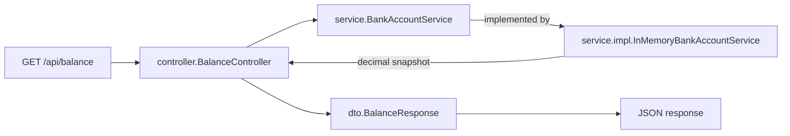

# Design Walkthrough

## Start with the application entry point

`FinancialAccountBalanceTrackerApplication` starts the application and enables
component scanning beneath its base package. The controller and service
implementation are discovered through their framework annotations.
`ProducerConfiguration` wires the random transaction factory and lifecycle-managed
producer when `tracker.producer.enabled` is true or unspecified.
`AuditConfiguration` creates the collector, bounded dispatcher and downstream
handler. The dispatcher's lifecycle phase starts it before the producers and
stops it after producer shutdown. The default downstream handler delegates packing
to `AuditBatchingService`, maps the result to DTOs and prints a JSON line.

## Follow a balance enquiry

1. `BalanceController` receives the GET request.
2. Constructor injection gives the controller a `BankAccountService`. The
   controller depends on the interface rather than constructing an implementation.
3. `InMemoryBankAccountService` reads the balance while holding the same monitor
   used for transaction updates.
4. The controller constructs a `BalanceResponse` DTO from the decimal snapshot
   and the GBP currency code.
5. The framework serializes the DTO as JSON. The controller also sets the HTTP
   status and cache-control header.

The controller handles HTTP concerns. Calculation and synchronization belong to
the service implementation. DTOs define external response shapes, while models
represent internal business data. The audit output follows the same separation.

## Follow a transaction

`model.Transaction` is an immutable record containing an ID and a signed amount.
Its constructor requires both values, rejects zero amounts and rejects fractional
pennies. Amounts are normalized to two decimal places without rounding.

`enums.TransactionType` names the two supported classifications: `CREDIT` and
`DEBIT`. The package is named `enums` because `enum` is a Java keyword.
`Transaction.type()` derives the classification from the amount's sign, keeping
the type consistent with the amount.

`BankAccountService.processTransaction` accepts a transaction. Inside a
synchronized method, the implementation calculates the next balance, records the
transaction with `TransactionAuditService`, then commits the balance. A rejected
audit hand-off leaves the balance unchanged.
The producers call this interface; they do not perform balance calculations
themselves.

## Follow automatic generation

`producer.RandomTransactionFactory` selects a random integer number of pennies
between 20,000 and 50,000,000 inclusive. It converts that value to a decimal amount,
applies the sign for the requested `TransactionType` and creates a random UUID.
Thread-local randomness supports calls from both producer threads.

`producer.TransactionProducer` owns two separate single-thread scheduled
executors. One executes credit generation on `credit-producer`; the other executes
debit generation on `debit-producer`. A fixed-rate period of 40 ms gives each a
target rate of 25 transactions per second.

The class implements `SmartLifecycle`. Startup schedules both recurring tasks,
and repeated startup calls do not create duplicate tasks. Shutdown cancels future
runs and waits for in-flight work with bounded timeouts. A runtime failure during
generation or processing logs an error and requests shutdown of both workers.
That failure path requests shutdown without waiting for the current worker to
join itself.

The configuration flag can remove the producer beans entirely. This keeps manual
balance checks and HTTP tests deterministic while allowing the normal application
to generate transactions automatically.

## Follow audit collection

```mermaid
flowchart LR
    Account["InMemoryBankAccountService"] --> Collector["TransactionAuditService"]
    Collector --> Window["Immutable AuditSubmission: 1000 transactions"]
    Window --> Queue["Bounded queue"]
    Queue --> Worker["audit-dispatcher thread"]
    Worker --> Handler["AuditSubmissionHandler"]
    Handler --> Packing["AuditBatchingService"]
    Packing --> Batches["Immutable AuditBatch values"]
    Batches --> Output["JSON summary on console"]
```

The collector keeps a partial window until the next transaction completes it.
It creates a defensive, immutable snapshot and offers it to the bounded queue.
Only a successful hand-off clears the partial window and advances the sequence.
This lets the account service reject a completing transaction without changing
its balance when the queue cannot accept the submission.

The queue hand-off does not wait for downstream work. Snapshot creation remains
inside the short transaction operation and costs O(N) at each window boundary.
The dedicated worker processes complete windows in FIFO order outside balance
locks. A slow handler therefore does not hold up balance enquiries.

On a handler failure, the dispatcher retains the failed in-flight submission and
the queued windows, logs the error and rejects new complete windows. There is no
automatic downstream retry. On normal shutdown, producers stop first and the
audit worker drains completed windows. Partial windows are not emitted because
they would violate the configured transaction count.

## Follow batch packing

`OptimizingAuditBatchingService` produces a minimum-count assignment of the original
transactions. `BestFitDecreasingAuditBatchingService` first creates a weighted,
absolute-pence view sorted largest first. A capacity-indexed `TreeMap` selects
the tightest fitting batch; equal remaining capacities share a deque. Each
constructed `AuditBatch` independently verifies its absolute-value limit.

Complete submissions of at most 18 items are solved using subset dynamic
programming. Larger submissions can use bounded small-set repair and
`LookaheadAuditBatchPacker` as accelerators. The lookahead starts each bin with
the largest remaining item, then compares a single-item fit with up to 96
deterministically sampled pair fits. Ordered magnitude queues retain every
original occurrence. Each constructed batch stays within capacity.
Their local work limits do not limit the subsequent complete certification.

`ExactAuditBatchPacker` combines the total-volume lower bound with sorted-prefix
cardinality bounds: if every item in a prefix has size at least w, no batch can
hold more than floor(capacity / w) prefix items. A packing that attains a valid
lower bound is immediately proven minimum-count.

Otherwise, the complete stage tests each candidate count from the lower bound
up to the feasible incumbent. Items are considered largest first. For a fixed
count, an iterative depth-first search explores placements into existing bins
and the next unused bin. Equal-load bins are interchangeable, so one
representative per load suffices. A residual gap smaller than the smallest item
can never be used; exceeding the candidate's total slack proves the partial
assignment infeasible. These pruning rules preserve every non-equivalent
feasible completion.

The first feasible candidate is the minimum. If all smaller candidates are
infeasible, the incumbent is the minimum. The result's lower bound is then the
proven batch count, so `optimalityProven()` is true for every successful default
packing. No local node budget or lack of improvement is interpreted as proof.

Explicit load, assignment and traversal arrays use O(N + B) exact-search state
and avoid a recursive stack frame per transaction. A memo cache uses a 16 MiB
entry-accounting budget and stores only proved-infeasible canonical states.
Eviction preserves completeness and allows those states to be explored again.
Worst-case search time is exponential. The fast stages and lower bounds establish many optima without
complete enumeration. Interruption raises `AuditProcessingException` and leaves
failure retention to the dispatcher; it never emits a partial optimisation result.
All mutable packing state is local to one call, and returned batches are immutable.

## Follow console output

`JsonAuditSubmissionHandler` calls the packing service, maps its batches to
`AuditBatchSummary` values, wraps them in `AuditSubmissionSummary` and
`AuditSubmissionOutput`, then serializes the document using the configured JSON
mapper. Each complete submission produces a single JSON line on the console.
Totals are numbers in pounds; counts are integers. Internal transaction IDs and
packing diagnostics are not added to the output contract.

A separate log entry reports sequence, size, batch count, lower bound and whether
optimality was proven. The handler checks the console stream for write errors;
an error propagates to the dispatcher, which retains the failed submission. A
partially written console line cannot be undone, and no retry is automatic.

## Follow an exception

Domain validation throws `InvalidTransactionException` or
`InvalidAuditSubmissionException`. Audit hand-off rejection becomes
`AuditUnavailableException`, preserving the rejection cause. Serialization,
console delivery and background handler failures become `AuditProcessingException`.
Validation stays with the models and services; exception classes carry no HTTP
annotations.

`exception.GlobalExceptionHandler` translates exceptions during HTTP requests
into standard problem responses. It delegates built-in MVC errors to the
framework so statuses such as 404, 405 and 406 retain their meaning and headers.
Explicit transaction validation maps to 400. Internal audit data/processing
failures and unexpected bugs map to safe 500 responses; audit unavailability maps
to 503. Server response identifiers link to detailed server logs without exposing
exception messages or causes in the response.

Worker-thread failures do not pass through the HTTP advice. The dispatcher
retains failed work, normalizes processing failures once, and rejects new complete
windows. The account still commits its balance only after successful audit
recording. The [error-handling guide](error-handling.md) describes these boundaries
and the tests that verify them.

## Explain money precision

`BigDecimal` represents amounts and the accumulated balance. Addition does not
round or convert through floating-point values. Returning the immutable decimal
object gives the caller a stable snapshot even if another transaction is processed
afterward.

The required `double retrieveBalance()` method remains available. It converts
only the returned snapshot. The REST endpoint uses `retrieveExactBalance()` so
the JSON number retains penny precision, including for large balances.

## Explain concurrency

Balance reads and updates synchronize on the same service instance. The update
is a read-modify-write operation, so the whole operation must be protected.

For example, starting at GBP 500.00, a credit of GBP 200.00 and a debit of
GBP 300.00 should result in GBP 400.00. If both updates read GBP 500.00 before
either writes, one can overwrite the other. Synchronization serializes the
updates and makes the resulting value visible to subsequent readers.

The framework creates a single service instance for the application. Tests can
construct a fresh implementation directly to isolate individual scenarios.

## Explain the tests

- `model.TransactionTests` covers signed values, transaction classifications,
  penny normalization and invalid inputs.
- `service.impl.InMemoryBankAccountServiceTests` covers calculations, negative
  balances, stable snapshots and 8,000 concurrent credits and debits with balance
  enquiries.
- `controller.BalanceControllerIntegrationTests` starts a real HTTP server on a
  random available port and uses the real account service. It checks the JSON
  contract, decimal precision, live updates, read-only requests and HTTP errors.
- `producer.RandomTransactionFactoryTests` covers inclusive amount boundaries,
  signs, whole pennies and generated IDs.
- `producer.TransactionProducerTests` checks scheduling through captured tasks
  and also observes real dedicated worker threads using latches. It covers normal
  shutdown, startup failures and processing failures without relying on exact
  wall-clock transaction counts.
- `config.ProducerConfigurationTests` checks conditional activation, automatic
  startup and shutdown when the application context closes.
- `model.AuditSubmissionTests` checks immutable snapshots and basic invariants.
- `model.AuditBatchTests` checks immutable assignments, absolute capacity,
  exact totals and lower-bound result invariants.
- `service.impl.InMemoryTransactionAuditServiceTests` checks the exact window
  boundaries, disjoint ordered windows, hand-off rejection and 100,000-item windows.
- `audit.AsyncAuditDispatcherTests` checks FIFO processing, separate worker
  execution, bounded queue rejection, draining and retained failure state.
- `config.AuditConfigurationTests` checks the default 1,000-item configuration,
  partial-window handling, invalid settings and account responsiveness with a
  deliberately slow downstream handler. It also exercises the default pipeline
  through collection, background packing and console JSON output.
- `service.impl.BestFitDecreasingAuditBatchingServiceTests` checks capacity
  boundaries, earlier-batch reuse, tightest-fit selection, duplicate occurrences,
  deterministic ordering, lower bounds and heuristic counterexamples. Seeded
  inputs verify exact totals and preservation of all 1,000 or 100,000 transactions.
- `service.impl.OptimizingAuditBatchingServiceTests` checks exact small solutions,
  duplicate occurrence preservation, the 18-item bound, non-increasing counts on
  large inputs, minimum-count certificates and completion after a local-search
  budget is exhausted.
- `service.impl.BoundedBatchRepackerTests` checks backtracking, repeated
  occurrences, capacity and combination infeasibility, the 128-item limit,
  budget exhaustion and independent subsequent calls.
- `service.impl.AuditPackingQualityTests` uses independent exhaustive bin assignments
  on four known cases and 32 seeded small cases. It checks that reported lower
  bounds never exceed the exact minimum and that the default small-input solver
  reaches that count. It also checks the repaired 1,000-item counterexample.
  Its separate implementation also validates bounded feasibility results against
  exact small-input minima. The oracle is limited to small test inputs.
- `service.impl.ExactAuditBatchPackerTests` checks complete infeasibility proof,
  cancellation and iterative traversal of 100,000 repeated occurrences.
- `service.impl.LookaheadAuditBatchPackerTests` checks minimum-bound closure
  on the seeded 100,000-item workload and occurrence preservation.
- `audit.JsonAuditSubmissionHandlerTests` parses the JSON contract and exercises
  console-write failures.
- The application context test verifies that the application configuration loads.

## Explain the scaling demonstration

`performance.AuditPerformanceScenario` is opt-in, separate from normal tests.
It constructs reproducible inputs before starting timers and measures two paths:
packing alone, and a burst of account updates through collection, queue hand-off,
background packing and JSON output to an in-memory stream. The latter uses the
real account service, collector, dispatcher and output handler.

Assertions, JSON parsing and worker shutdown are outside timed regions. The
demonstration checks that every input occurrence survives packing, output counts
and absolute totals match, and the final account balance is exact. It reports
packing quality alongside timings, including a simple arrival-order baseline.
The [performance report](performance.md) defines the measurements and their limits.

## Runtime and measurement model

The balance, partial window, queued submissions and any failed in-flight work are
in memory and are lost on restart. Successful default packings are minimum-count.
Correctness tests and local timing samples demonstrate the larger window. The
timing demonstration measures the defined local workload; it is not a production load test. It excludes
rate-limited generation, HTTP traffic, terminal output of the JSON payload,
sustained queue contention and durable storage.
