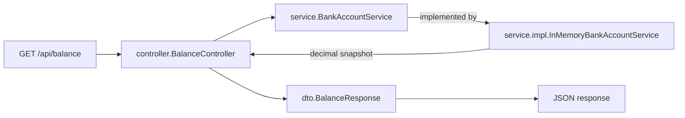

# Design Walkthrough

## Start with the application entry point

`FinancialAccountBalanceTrackerApplication` starts the application and enables
component scanning beneath its base package. The controller and service
implementation are discovered through their framework annotations.
`ProducerConfiguration` wires the random transaction factory and lifecycle-managed
producer when `tracker.producer.enabled` is true or unspecified.

## Follow a balance enquiry

1. `BalanceController` receives the GET request.
2. Constructor injection gives the controller a `BankAccountService`. The
   controller depends on the interface rather than constructing an implementation.
3. `InMemoryBankAccountService` reads the balance while holding the same monitor
   used for transaction updates.
4. The controller constructs a `BalanceResponse` DTO from the decimal snapshot
   and the GBP currency code.
5. The framework serializes the DTO as JSON. The controller also sets the HTTP
   status and cache-control header.

The controller handles HTTP concerns. Calculation and synchronization belong to
the service implementation. The DTO defines the external response shape, while
the transaction model represents internal business data.

## Follow a transaction

`model.Transaction` is an immutable record containing an ID and a signed amount.
Its constructor requires both values, rejects zero amounts and rejects fractional
pennies. Amounts are normalized to two decimal places without rounding.

`enums.TransactionType` names the two supported classifications: `CREDIT` and
`DEBIT`. The package is named `enums` because `enum` is a Java keyword.
`Transaction.type()` derives the classification from the amount's sign, keeping
the type consistent with the amount.

`BankAccountService.processTransaction` accepts a transaction. The implementation
adds its signed amount to the existing balance inside a synchronized method.
The producers call this interface; they do not perform balance calculations
themselves.

## Follow automatic generation

`producer.RandomTransactionFactory` selects a random integer number of pennies
between 20,000 and 50,000,000 inclusive. It converts that value to a decimal amount,
applies the sign for the requested `TransactionType` and creates a random UUID.
Thread-local randomness supports calls from both producer threads.

`producer.TransactionProducer` owns two separate single-thread scheduled
executors. One executes credit generation on `credit-producer`; the other executes
debit generation on `debit-producer`. A fixed-rate period of 40 ms gives each a
target rate of 25 transactions per second.

The class implements `SmartLifecycle`. Startup schedules both recurring tasks,
and repeated startup calls do not create duplicate tasks. Shutdown cancels future
runs and waits for in-flight work with bounded timeouts. A runtime failure during
generation or processing logs an error and requests shutdown of both workers.
That failure path requests shutdown without waiting for the current worker to
join itself.

The configuration flag can remove the producer beans entirely. This keeps manual
balance checks and HTTP tests deterministic while allowing the normal application
to generate transactions automatically.

## Explain money precision

`BigDecimal` represents amounts and the accumulated balance. Addition does not
round or convert through floating-point values. Returning the immutable decimal
object gives the caller a stable snapshot even if another transaction is processed
afterward.

The required `double retrieveBalance()` method remains available. It converts
only the returned snapshot. The REST endpoint uses `retrieveExactBalance()` so
the JSON number retains penny precision, including for large balances.

## Explain concurrency

Balance reads and updates synchronize on the same service instance. The update
is a read-modify-write operation, so the whole operation must be protected.

For example, starting at GBP 500.00, a credit of GBP 200.00 and a debit of
GBP 300.00 should result in GBP 400.00. If both updates read GBP 500.00 before
either writes, one can overwrite the other. Synchronization serializes the
updates and makes the resulting value visible to subsequent readers.

The framework creates a single service instance for the application. Tests can
construct a fresh implementation directly to isolate individual scenarios.

## Explain the tests

- `model.TransactionTests` covers signed values, transaction classifications,
  penny normalization and invalid inputs.
- `service.impl.InMemoryBankAccountServiceTests` covers calculations, negative
  balances, stable snapshots and 8,000 concurrent credits and debits with balance
  enquiries.
- `controller.BalanceControllerIntegrationTests` starts a real HTTP server on a
  random available port and uses the real account service. It checks the JSON
  contract, decimal precision, live updates, read-only requests and HTTP errors.
- `producer.RandomTransactionFactoryTests` covers inclusive amount boundaries,
  signs, whole pennies and generated IDs.
- `producer.TransactionProducerTests` checks scheduling through captured tasks
  and also observes real dedicated worker threads using latches. It covers normal
  shutdown, startup failures and processing failures without relying on exact
  wall-clock transaction counts.
- `config.ProducerConfigurationTests` checks conditional activation, automatic
  startup and shutdown when the application context closes.
- The application context test verifies that the application configuration loads.

## Keep the current limits visible

The state is in memory and is lost on restart. Audit collection and batching are
upcoming stages; processed transactions are not yet retained for audit.
